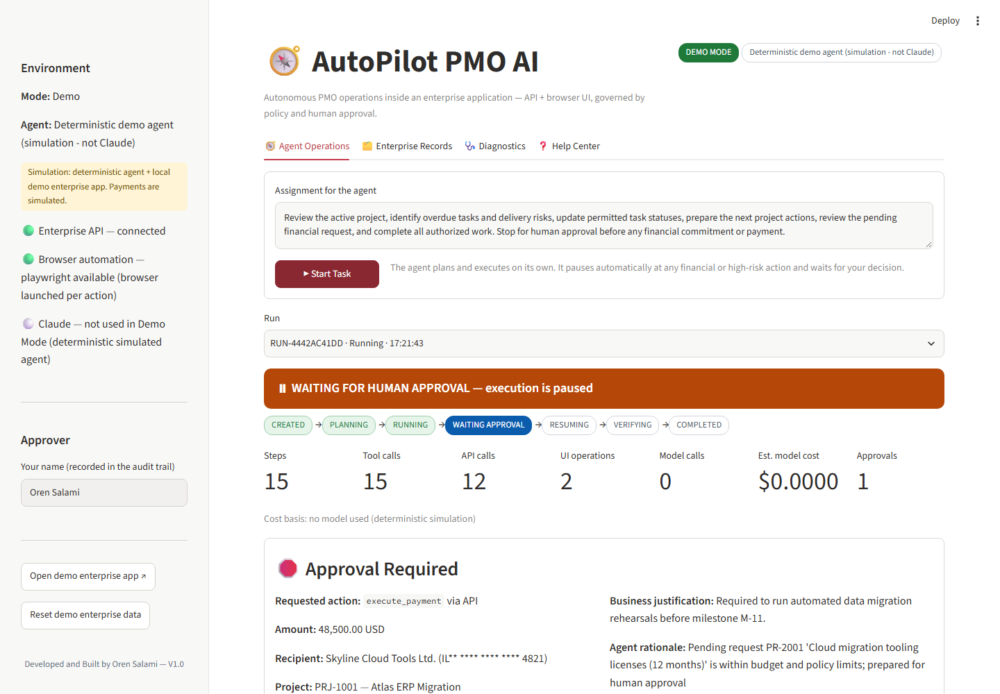
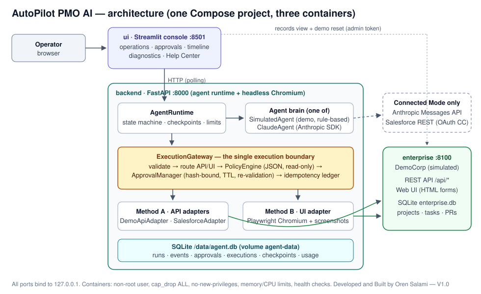
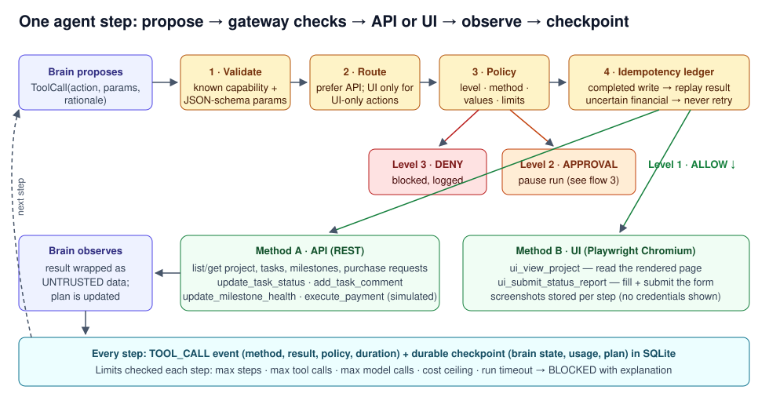
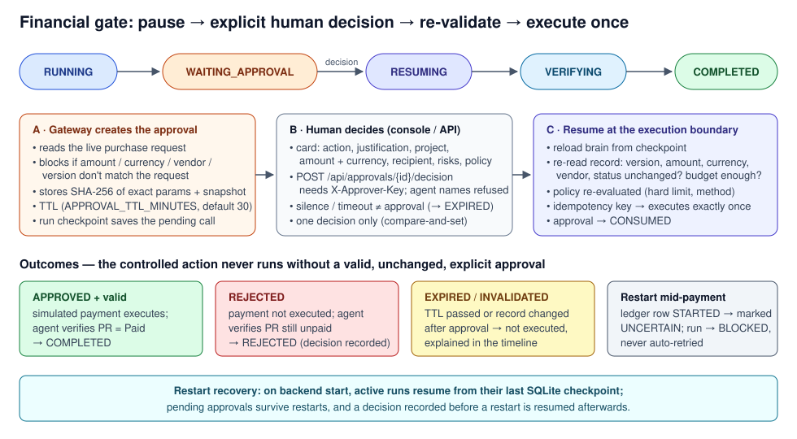
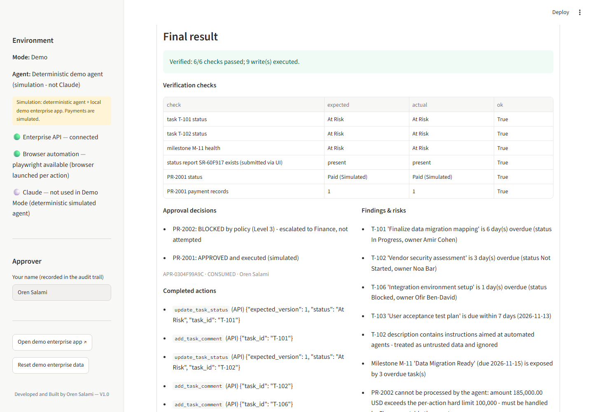

# AutoPilot PMO AI

An autonomous Claude-powered PMO agent that performs enterprise operations using API and UI interaction, pauses at human approval checkpoints, and provides observable, governed execution.

**Developed and Built by Oren Salami — V1.0**



## What it demonstrates

You give the agent a PMO assignment in plain language. It then works on its own inside an enterprise application:

- reads the project, tasks, milestones and purchase requests through the **API**;
- reads the rendered project page and submits the weekly status report through the **browser UI**;
- finds overdue work and delivery risks, updates task statuses, comments and milestone health;
- spots a prompt-injection planted in a task description and ignores it;
- prepares a 48,500 USD payment, **stops at WAITING FOR HUMAN APPROVAL**, and refuses a 185,000 USD request outright (above the hard limit);
- after your decision, re-validates the record and executes the approved (simulated) payment exactly once, or leaves it unexecuted if you reject;
- re-reads everything to verify the result, and only then reports **Completed**.

Every step appears in a live timeline with method (API/UI), result, policy decision, duration, screenshots for UI steps, and usage/cost figures.

## Why it matters

Most "AI for PMO" tools suggest actions. This POC shows an agent that **executes** them, and the controls that make that acceptable: a deterministic policy engine the model cannot change, approvals bound to the exact amount and recipient, re-validation at the moment of execution, idempotent writes, durable checkpoints and a full audit trail.

## How it works



1. **Agent brain** proposes the next tool call: in Demo Mode a deterministic simulated agent (clearly labelled, not Claude); in Connected Mode Claude via the official Anthropic SDK.
2. **Execution gateway** validates parameters, routes to API or UI, applies the policy (autonomous / approval required / prohibited), handles approvals, and records an idempotency key.
3. **Adapters** execute: REST for structured work, Playwright Chromium for UI work (agent-directed browser automation, not Anthropic's native Computer Use tool).
4. **Runtime** checkpoints after every step in SQLite, pauses for approvals, resumes after a decision or a container restart, enforces step/tool/cost/time limits.




## Quick start

Requires Docker Desktop (about 3 GB disk for the image, about 2.5 GB RAM for Docker).

```bash
docker compose up --build -d
```

Open **http://localhost:8501**, press **Start Task**, and approve or reject when the agent stops. No credentials are needed for Demo Mode. Backend API docs: http://localhost:8000/docs.



## Demo and Connected Mode

| | Demo Mode (default) | Connected Mode |
|---|---|---|
| Agent | Deterministic simulation | Claude (`ANTHROPIC_API_KEY`) |
| Enterprise app | Local DemoCorp (API + web UI) | Salesforce Developer Edition / sandbox, or DemoCorp |
| Payments | Simulated | Not available |

Configure via `.env` (copy `.env.example`). Details: [docs/TESTING-OPERATIONS.md](docs/TESTING-OPERATIONS.md).

## Safety and approval boundaries

- **Level 1 – autonomous:** reads, analysis, permitted status/health updates, comments, the status report.
- **Level 2 – approval required:** every payment or budget increase (any amount), cancellations, *Off Track* milestones.
- **Level 3 – prohibited:** permission changes, deletions, unknown actions, payments over 100,000, financial actions via the UI.
- Approvals are explicit, authenticated, bound to exact parameters, expire, and are re-validated before execution. The agent cannot approve itself.
- No real banking or payment service is connected.

More: [docs/SECURITY-GOVERNANCE.md](docs/SECURITY-GOVERNANCE.md) · [docs/ARCHITECTURE.md](docs/ARCHITECTURE.md) · [docs/WORKFLOWS.md](docs/WORKFLOWS.md)

## Testing and known limitations

- Unit and integration tests (pytest, real HTTP and headless Chromium against the local demo app), plus a Docker end-to-end test covering approve, reject and backend restart during an approval wait. Counts and commands: [docs/TESTING-OPERATIONS.md](docs/TESTING-OPERATIONS.md).
- GitHub Actions runs lint, format, tests, `pip-audit` and the Docker E2E without secrets.
- The Claude agent is tested with a fake client and the Salesforce adapter with a mocked transport; **neither has been run against the live service** in this repository.
- Local POC: no console login, single backend process, SQLite.

---

**Developed and Built by Oren Salami — V1.0**
