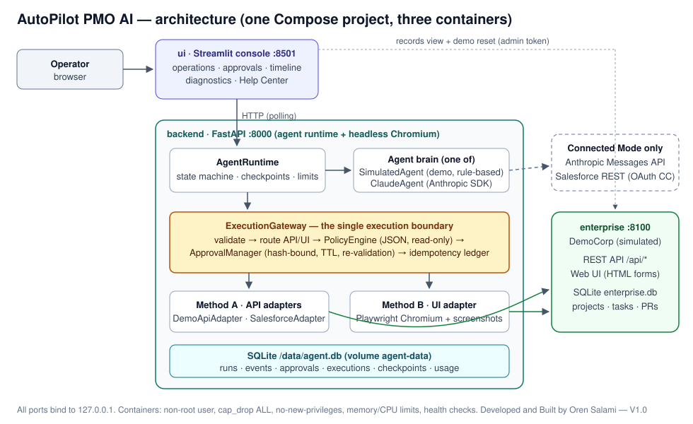
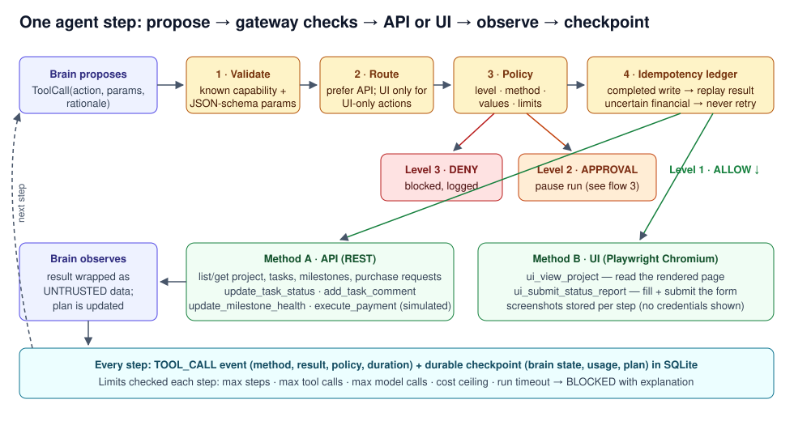

# Architecture

AutoPilot PMO AI is one Python code base packaged as one Docker image and run as three Compose services. One agent runtime drives one agent "brain" at a time; every action the brain proposes goes through a single execution gateway that the brain cannot bypass or reconfigure.

## Components

| Module | Responsibility |
|---|---|
| `app/agent/runtime.py` — `AgentRuntime` | Runs the step loop in a background thread, enforces the run state machine and execution limits, writes a durable checkpoint after every step, pauses at approval checkpoints, resumes after a decision or a restart. |
| `app/agent/simulated.py` — `SimulatedAgent` | Demo-mode brain. Rule-based and deterministic. It reads live records and derives its plan from them, but it is **not Claude** and is labelled as a simulation everywhere. |
| `app/agent/claude_agent.py` — `ClaudeAgent` | Connected-mode brain. Uses the official `anthropic` Python SDK (Messages API, client-side tools, manual loop) so a run can stop at an approval and resume later from the stored conversation. Claude only *proposes* tool calls. |
| `app/workflows/gateway.py` — `ExecutionGateway` | The only path to an adapter: parameter validation → API/UI routing → policy → approval gate → idempotency ledger → adapter → event. |
| `app/policies/engine.py` + `default_policy.json` | Deterministic policy engine. Loaded read-only at start-up; no agent tool can read-modify-write it. Default decision for unknown actions is *prohibited*. |
| `app/workflows/approvals.py` — `ApprovalManager` | Human decisions. Approvals are bound to a SHA-256 hash of the exact action parameters plus a record snapshot, expire after a TTL, and can only be decided with the approver key by a non-agent identity. |
| `app/adapters/` | `EnterpriseAdapter` protocol; `DemoApiAdapter` (REST), `DemoUiAdapter` (Playwright), `SalesforceAdapter` (REST); `Toolbox` merges them into one capability catalogue and routes each call. |
| `app/core/store.py` | SQLite persistence (WAL): runs, events, approvals, executions ledger, checkpoints, usage. |
| `app/core/states.py` | Run state machine. Illegal transitions raise. |
| `app/core/redaction.py`, `app/observability/` | Redaction of secrets in logs/events/exports, JSON logging, usage and cost tracking, limits. |
| `app/api/main.py` | FastAPI backend consumed by the console (runs, events, approvals, audit export, diagnostics, screenshots). |
| `app/demo/` | DemoCorp, the simulated enterprise application: its own REST API, server-rendered web UI, and SQLite database with seeded PMO data. |
| `ui/streamlit_app.py` | Operator console: operations, approval card, timeline, step details with screenshots, enterprise records, diagnostics, Help Center. |

Wiring happens in one place, `app/container.py`, which builds the object graph from environment settings (`app/config.py`). Tests use the same function with fakes injected.

## Claude integration

- SDK: `anthropic` (official). Model, effort and pricing come from environment variables (`CLAUDE_MODEL`, default `claude-opus-5-5`).
- The system prompt states the operating rules, but rules are **not** enforced by the prompt: the gateway and policy engine enforce them regardless of what the model says.
- Every tool result is wrapped as untrusted enterprise data before it goes back to the model.
- `finish_run` is a dedicated tool. The runtime accepts the model's report but records its own verification state; a run is never shown as completed before the final verification step.
- Without `ANTHROPIC_API_KEY` the run fails immediately with an explanation; nothing is simulated in its place.
- The Claude loop is tested with a deterministic fake client (`tests/integration/test_claude_agent.py`). It has **not** been run against the live Anthropic API in this repository.

## Hybrid execution: API and UI

- **Method A — API.** Structured reads and writes through REST (`DemoApiAdapter`, or `SalesforceAdapter` in connected mode). Preferred whenever a structured operation exists.
- **Method B — UI.** `DemoUiAdapter` drives headless Chromium through Playwright: it opens the DemoCorp web UI, reads rendered pages and fills/submits forms, and stores a screenshot per step. This is **agent-directed browser automation, not Anthropic's native Computer Use tool**. The agent chooses the UI action; the adapter executes it with deterministic selectors.
- **Routing.** `Toolbox.route()` uses the API unless the action exists only in the UI (the weekly status report form in DemoCorp has no API on purpose) or the caller explicitly requests UI. The policy then decides whether that method is allowed for that action; financial actions are API-only, so the UI cannot be used to get around a restriction.

## Persistence and recovery

- Backend: `/data/agent.db` on the `agent-data` volume. DemoCorp: `/data/enterprise.db` on the `enterprise-data` volume.
- On start-up the runtime calls `recover()`: active runs resume from their last checkpoint; runs waiting for approval stay waiting (or resume if a decision was recorded before the restart); a financial execution that was in flight is marked *uncertain* and the run is blocked for operator reconciliation, never retried.

## Docker structure

| Service | Port (host, 127.0.0.1 only) | Purpose | Limits |
|---|---|---|---|
| `enterprise` | 8100 | DemoCorp API + web UI | 0.5 CPU, 256 MB |
| `backend` | 8000 | FastAPI + agent runtime + headless Chromium | 1.5 CPU, 1.5 GB, `shm_size` 512 MB |
| `ui` | 8501 | Streamlit console | 0.75 CPU, 768 MB |

All three use the same image (`python:3.12-slim-bookworm` + Playwright Chromium, ~2.5 GB uncompressed), run as a non-root user (uid 10001) with `cap_drop: ALL`, `no-new-privileges`, health checks, log rotation and `restart: unless-stopped`. Start order follows health: enterprise → backend → ui.

## Deployment boundaries

- This is a local proof of concept. Ports bind to `127.0.0.1`; there is no TLS, user management or multi-tenant isolation.
- The demo tokens in `.env.example` are placeholders for a local demo, not secrets. Change them before exposing anything.
- No component connects to a bank or payment service. "Payments" are status changes in the simulated DemoCorp application.
- Salesforce support in V1.0 is limited to reads plus Task status/comment writes through OAuth 2.0 client credentials; it has no UI adapter and no financial action. It is tested only against a mocked transport.
- Adding another enterprise system (for example Priority ERP) means adding an adapter that implements `EnterpriseAdapter` and policy entries for its actions; the runtime, gateway and UI do not change.

Developed and Built by Oren Salami — V1.0
