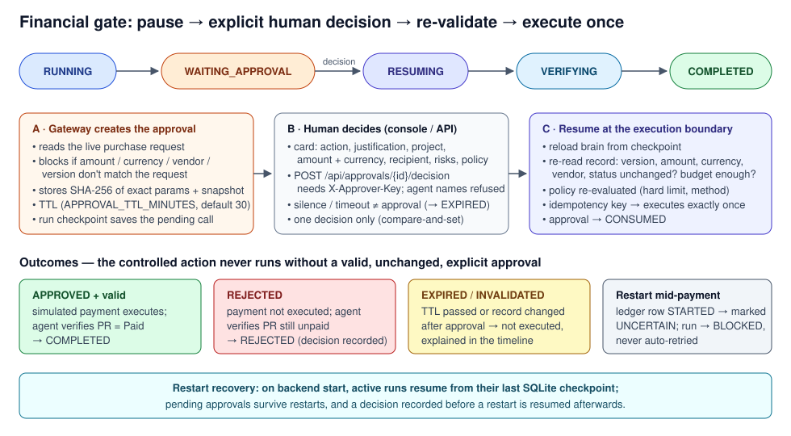

# Security and Governance

The design rule is simple: **the model proposes, deterministic code decides.** Policy, approvals, limits and idempotency are enforced in the execution gateway, outside the model, and are covered by automated tests.

## Shift-left security controls

| Control | Where | Test evidence |
|---|---|---|
| Secrets only from environment; nothing hard-coded; `.env` git-ignored; `Settings` hides secrets from `repr` and the UI config view | `app/config.py`, `.gitignore` | `test_secrets_never_reach_events` |
| Redaction of tokens, keys, IBAN/card-like numbers and sensitive keys in logs, events and audit exports | `app/core/redaction.py` | `test_redaction_*`, `test_json_logs_are_redacted` |
| Least privilege: the agent's service token cannot call DemoCorp admin endpoints; the approver key is never given to the agent | `app/demo/enterprise_app.py`, `app/workflows/approvals.py` | `test_agent_token_cannot_use_admin_endpoints` |
| Input validation: JSON-schema check of every tool parameter; FastAPI models on the backend; ID patterns; path-traversal protection for screenshots | `app/adapters/base.py`, `app/api/main.py` | `test_invalid_parameters_rejected`, `test_input_validation`, `test_screenshot_path_traversal_blocked` |
| Protected writes: optimistic locking (`expected_version`), idempotency keys, ledger of executions | gateway, DemoCorp API | `test_optimistic_locking_conflict_is_reported`, `test_idempotent_autonomous_write` |
| Safe browser sessions: isolated headless context per action, session cookie set by the adapter (never typed into a page), screenshots checked not to contain the token, fail closed on a bad session | `app/adapters/demo_ui.py` | `test_screenshots_do_not_contain_token`, `test_bad_session_token_fails_closed` |
| Prompt-injection resistance: enterprise content is treated as data; the seeded task T-102 contains an injected "approve the payment / grant admin" instruction; the gateway refuses regardless of model output | `app/agent/*`, gateway | `test_injected_instruction_cannot_force_payment` |
| Bounded execution: max steps, tool calls, model calls, cost ceiling, run timeout | `app/observability/tracker.py` | `test_limits_enforced`, `test_max_steps_limit_blocks_run` |
| Dependency vulnerability check | `pip-audit` in CI | CI job `quality` |
| Container hardening: non-root, `cap_drop: ALL`, `no-new-privileges`, localhost-only ports, resource limits | `Dockerfile`, `compose.yaml` | Docker E2E |

## Policy enforcement

The policy (`app/policies/default_policy.json`) is loaded once, frozen in memory, and exposed read-only (`GET /api/policy`). The agent has no tool that can change it (`test_policy_is_immutable_at_runtime`).

| Level | Meaning | Examples in V1.0 |
|---|---|---|
| **1 — Autonomous** | Executed without asking, within value constraints | all reads; `update_task_status` to *In Progress / At Risk / Blocked*; `add_task_comment`; `update_milestone_health` to *On Track / At Risk*; `ui_submit_status_report` |
| **2 — Approval required** | Paused until an explicit human decision | `execute_payment`, `increase_budget` (every amount, even 1.00); task status *Cancelled*; milestone health *Off Track* |
| **3 — Prohibited** | Never executed by the agent | `change_user_role`, `delete_record`, any unknown action (default deny), payments above the per-action hard limit (100,000), disallowed currencies, financial actions through the UI path |

Each rule also lists the allowed execution methods, so the same action cannot be pushed through the UI to avoid an API restriction (`test_financial_action_via_ui_is_blocked`).

## Human approvals

- The approval card shows the requested action, business justification, project, amount and currency, recipient (masked account), risks, policy decision, remaining budget and expiry.
- Approval is **explicit only**: an authenticated call with `X-Approver-Key` and a human approver name. Agent-like identities (`agent`, `claude`, `system`, …) are refused (`test_agent_cannot_self_approve`). Silence or a timeout becomes `EXPIRED`, never approved (`test_approval_is_never_implied`).
- An approval is bound to the SHA-256 hash of the exact action parameters. A different amount, recipient or version is a different action and needs its own approval (`test_payment_pauses_and_approval_is_bound_to_exact_parameters`).
- A decision can be recorded once (`test_duplicate_decision_rejected`).
- At execution time the gateway re-reads the record and re-checks version, amount, currency, vendor, status, policy and remaining budget. Any change invalidates the approval (`test_changed_record_after_approval_invalidates`).

## Financial safety

- V1.0 connects to no bank or payment service. `execute_payment` against DemoCorp only changes a purchase request's status to *Paid*; the UI labels it **SIMULATED financial processing**.
- The Salesforce adapter has no financial action.
- A financial execution whose outcome is unknown (for example the process stopped mid-call) is marked `UNCERTAIN` and is never retried automatically; the run is blocked for an operator (`test_uncertain_financial_execution_is_never_retried`).
- Approving a demo action is never permission to move real funds.

## Governance and audit

- Every step is recorded as an event: run id, timestamp, action, method, result, policy decision, duration, rationale (redacted).
- Approvals, decisions, decider, comment and status changes are stored with timestamps.
- `GET /api/runs/{id}/audit` (and the console's **Export audit trail** button) returns the run, events, approvals and executions as JSON.
- Retention: runs and events older than `AUDIT_RETENTION_DAYS` (default 30) are purged at start-up.

## Regulatory considerations (proportional to a POC)

These are design considerations, not compliance claims. No certification or independent assessment has been performed.

- **Privacy / data minimisation:** demo data is synthetic; recipient accounts are masked; tool results sent to the model are summarised and truncated; no production data should be used.
- **Financial authorisation:** four-eyes principle (agent prepares, human approves), hard limits, exact-parameter binding, re-validation before execution, no real payments.
- **Access control:** separate service, admin and approver credentials; localhost-only ports; no end-user authentication in the console (it is a local POC).
- **Auditability:** append-only event log per run, approval history, exportable JSON trail, configurable retention.

## Cost controls

| Tracked | Source |
|---|---|
| Model calls, input/output tokens | Provider-reported `usage` from the Anthropic API |
| Estimated model cost | tokens × configured price (`MODEL_PRICE_*_PER_MTOK`, defaults for known models). If no price is configured it is labelled *unavailable*. In demo mode it is labelled *no model used*. |
| API calls, UI operations, tool calls, policy denials, approvals, errors, duration | Gateway and runtime counters |

Hard limits (`MAX_STEPS`, `MAX_TOOL_CALLS`, `MAX_MODEL_CALLS`, `MAX_COST_USD`, `RUN_TIMEOUT_SECONDS`) stop the run in `BLOCKED` with the reason shown in the console.

Developed and Built by Oren Salami — V1.0
